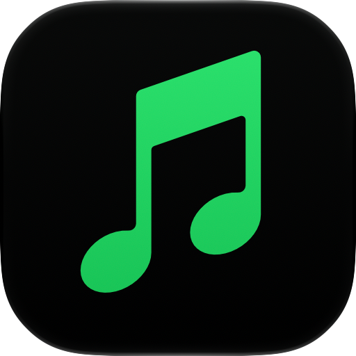
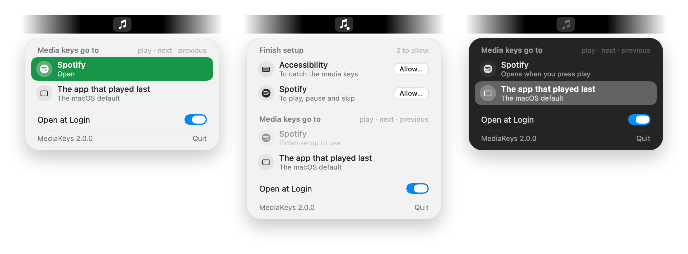

<p align="center">
  
</p>

<h1 align="center">MediaKeys for Spotify</h1>

<p align="center">
  Your keyboard's play, pause and skip keys, always for Spotify.
</p>

<p align="center">
  macOS 26 or later &nbsp;·&nbsp; Free and open source
</p>

---

On a Mac, the play key goes to whichever app last played sound. Press it and you might get a YouTube tab, Apple Music, or a video you closed an hour ago.

MediaKeys for Spotify fixes that. It sits in your menu bar and sends play/pause, next and previous straight to Spotify, whatever app you're in.

<p align="center">
  
</p>

- **Set it and forget it.** Allow two permissions once and it just works, every time you log in.
- **Starts Spotify for you.** If Spotify isn't open, pressing play opens it in the background and starts the music.
- **Easy to switch off.** Pick **The app that played last** in the panel and your keys work the way they normally do.
- **Private.** No account, no tracking, and it never connects to the internet.
- **Small and native.** Made for macOS, on Apple silicon and Intel Macs.

## Install

You need macOS 26 or later and [Xcode](https://apps.apple.com/app/xcode/id497799835) 26 or later (free from the App Store). In Terminal, run:

```bash
git clone https://github.com/racejohnson/mediakeys-for-spotify.git
cd mediakeys-for-spotify
./scripts/install.sh
```

This builds the app, puts it in your **Applications** folder and opens it. To update later, run `git pull` and `./scripts/install.sh` again.

## Set up

When you first open the app, its panel opens under the note in your menu bar and asks for two permissions, as in the middle picture above.

- **Accessibility** lets MediaKeys catch the media keys before other apps do. Click **Allow…**, choose **Open System Settings** when macOS asks, then switch on MediaKeys for Spotify. If you closed that prompt, click **Open Settings** in the panel.
- **Spotify** lets MediaKeys tell Spotify to play, pause and skip. Click **Allow…**. Spotify opens in the background if it's closed, and macOS asks once: click **Allow**.

The panel stays open while you do this. Once both are allowed, the two rows say **All set** and go away, and Spotify has the keys. You need the Spotify desktop app; if it isn't installed, the panel links to it.

## Use it

MediaKeys has no Dock icon; it lives in your menu bar as ♫. Click it to open the panel, and click it again to close it.

- **Media keys go to**: the filled row has the keys. Click **Spotify** to send them there, or **The app that played last** to give them back to macOS for a while.
- **Spotify's second line** says whether it's open. If it's closed, pressing play opens it. If Spotify isn't installed or setup isn't finished, the row is dimmed, says why and can't be chosen; neither row is filled until Spotify can take the keys.
- **Finish setup** shows at the top only while a permission is missing.
- **Open at Login**: on by default. If macOS needs your approval first, the panel says so and links to Login Items.
- **Quit**, next to the version.

From the keyboard: Tab moves between the rows, Return chooses one, and Esc closes the panel.

The icon looks like  while Spotify has the keys, dims to  while the keys are with the app that played last, and shows a small dot  when Spotify can't take the keys yet: a permission is missing or Spotify isn't installed.

## Questions

**Can MediaKeys see what I type?**
No. It only listens to the special keys, like play and volume, never letters or numbers, and it acts only on play/pause, next and previous. macOS lists this under Accessibility, which is why it asks for that permission.

**My media keys go to other apps instead of Spotify.**
Click the menu bar icon. Make sure **Spotify** is the filled row, and if you see **Finish setup**, allow what's missing. If Accessibility already looks allowed but keys still don't reach Spotify, open **System Settings → Privacy & Security → Accessibility**, select MediaKeys for Spotify, click **−**, then click **+** and add it again from Applications. This can happen after an update.

**Does it work with Spotify in a web browser?**
No. It controls the [Spotify desktop app](https://www.spotify.com/download).

**Why does holding the next key only skip once?**
On purpose: each press counts once, so a held key can't race through your queue.

**How do I uninstall it?**
Open the panel, turn off **Open at Login** and click **Quit**. Then drag MediaKeys for Spotify from Applications to the Trash. You can also remove it from **Accessibility** and **Automation** in **System Settings → Privacy & Security**. To remove its saved settings too, run `defaults delete com.racejohnson.mediakeys-for-spotify` in Terminal.

## For developers

It's a Swift package; there's no Xcode project.

```bash
./scripts/run-dev.sh           # build a debug copy and open it
./scripts/build-dmg.sh         # build/MediaKeys-for-Spotify.dmg
./scripts/readme-pictures.sh   # redraw this page's pictures from made-up state
./scripts/icon.sh              # rewrite the icon's note from the menu bar's, and re-export docs/icon.png
swift test                     # run the tests
```

Builds are signed with the first Developer ID or Apple Development certificate in your keychain, or ad-hoc if there's none. Set `SIGN_IDENTITY` to pick one (`-` forces ad-hoc). Ad-hoc builds lose the Accessibility permission on every rebuild, so a free Apple Development certificate (Xcode → Settings → Accounts) is worth having.

## License

[MIT](LICENSE). MediaKeys for Spotify is an independent project, not affiliated with or endorsed by Spotify. Spotify and its logo are trademarks of Spotify AB; the logo appears in the panel only to name where the keys go. The note in the app icon and menu bar follows the one on Apple's Music icon; MediaKeys is not affiliated with or endorsed by Apple.
