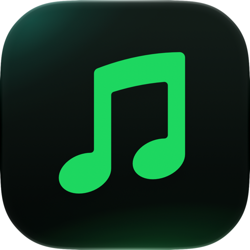
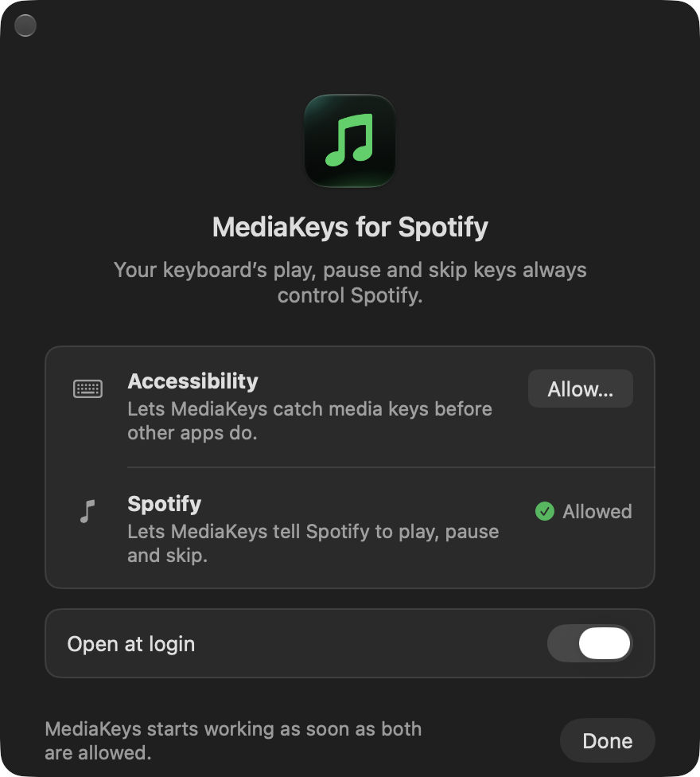

<p align="center">
  
</p>

<h1 align="center">MediaKeys for Spotify</h1>

<p align="center">
  Your keyboard's play, pause and skip keys, always for Spotify.
</p>

<p align="center">
  <a href="https://github.com/racejohnson/mediakeys-for-spotify/releases/latest/download/MediaKeys-for-Spotify.dmg"><b>Download for Mac</b></a>
  &nbsp;·&nbsp; macOS 14 or later &nbsp;·&nbsp; Free and open source
</p>

---

On a Mac, the play key goes to whichever app last played sound. Press it and you might get a YouTube tab, Apple Music, or a video you closed an hour ago.

MediaKeys for Spotify fixes that. It sits in your menu bar and sends play/pause, next and previous straight to Spotify, whatever app you're in.

- **Set it and forget it.** Allow two permissions once and it just works, every time you log in.
- **Starts Spotify for you.** If Spotify isn't open, pressing play opens it in the background and starts the music.
- **Easy to switch off.** Turn it off from the menu bar and your keys work the way they normally do.
- **Private.** No account, no tracking, and it never connects to the internet.
- **Small and native.** Made for macOS, on Apple silicon and Intel Macs.

## Install

1. [Download MediaKeys-for-Spotify.dmg](https://github.com/racejohnson/mediakeys-for-spotify/releases/latest/download/MediaKeys-for-Spotify.dmg).
2. Open it and drag **MediaKeys for Spotify** into your **Applications** folder.
3. Open the app from Applications.

The app isn't notarized by Apple, so the first time you open it macOS may say it can't verify it. Close that message, go to **System Settings → Privacy & Security**, scroll down, and click **Open Anyway**. You only do this once.

## Set up

When you first open the app, a setup window asks for two permissions.

<p align="center">
  
</p>

- **Accessibility** lets MediaKeys catch the media keys before other apps do. Click **Allow…** and switch on MediaKeys for Spotify in the list that opens.
- **Spotify** lets MediaKeys tell Spotify to play, pause and skip. Click **Allow…**, then **Allow** again when macOS asks.

Once both show **Allowed**, you're done. You need the Spotify desktop app; if it isn't installed, the setup window links to it.

## Use it

MediaKeys has no Dock icon; it lives in your menu bar as ♫. Click it for:

- **Send Media Keys to Spotify**: uncheck it to give the keys back to macOS for a while.
- **Open at Login**: on by default.
- **Setup…**: reopens the setup window. It reads **Finish Setup…** when a permission is missing.
- **About** and **Quit**.

The icon dims while MediaKeys is off and shows a small dot when setup isn't finished.

## Questions

**Can MediaKeys see what I type?**
No. It only listens to the special keys, like play and volume, never letters or numbers, and it acts only on play/pause, next and previous. macOS lists this under Accessibility, which is why it asks for that permission.

**My media keys go to other apps instead of Spotify.**
Click the menu bar icon. Make sure **Send Media Keys to Spotify** is checked, and if you see **Finish Setup…**, open it and allow what's missing. If Accessibility already looks allowed but keys still don't reach Spotify, open **System Settings → Privacy & Security → Accessibility**, select MediaKeys for Spotify, click **−**, then open MediaKeys and allow it again. This can happen after an update.

**Does it work with Spotify in a web browser?**
No. It controls the [Spotify desktop app](https://www.spotify.com/download).

**Why does holding the next key only skip once?**
On purpose: each press counts once, so a held key can't race through your queue.

**How do I uninstall it?**
Click the menu bar icon, choose **Quit**, and drag the app from Applications to the Trash. You can also remove it from **Accessibility** and **Automation** in **System Settings → Privacy & Security**.

## Build from source

You need macOS 14 or later and Xcode 26 or later. It's a Swift package; there's no Xcode project.

```bash
./scripts/install.sh      # build, install to /Applications and open
./scripts/run-dev.sh      # build a debug copy and open it
./scripts/build-dmg.sh    # build/MediaKeys-for-Spotify.dmg
swift test                # run the tests
```

Builds are signed with the first Developer ID or Apple Development certificate in your keychain, or ad-hoc if there's none. Set `SIGN_IDENTITY` to pick one (`-` forces ad-hoc). Ad-hoc builds lose the Accessibility permission on every rebuild, so a free Apple Development certificate (Xcode → Settings → Accounts) is worth having.

## License

[MIT](LICENSE). MediaKeys for Spotify is an independent project, not affiliated with or endorsed by Spotify. Spotify is a trademark of Spotify AB.
